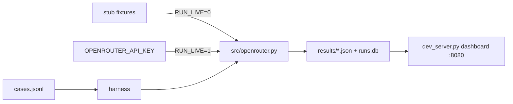
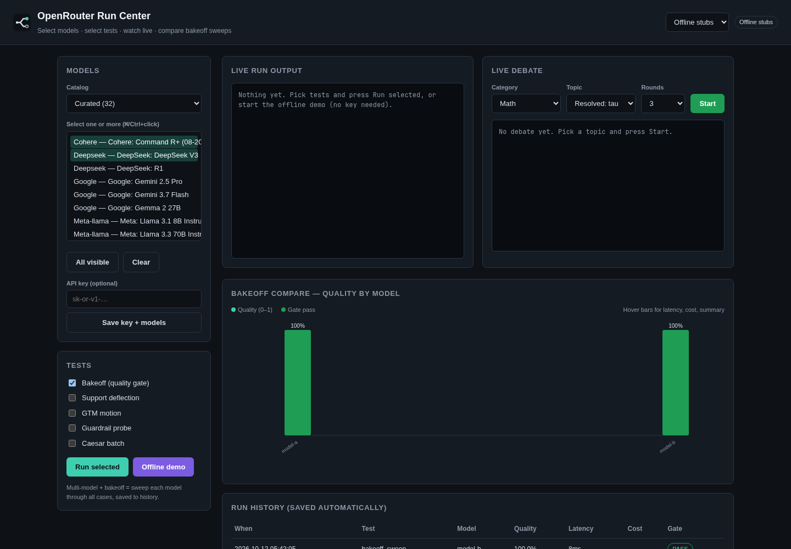

<p align="center">
  <picture>
    <source media="(prefers-color-scheme: dark)" srcset="assets/brand/wordmark-dark.svg">
    
  </picture>
</p>

# OpenRouter Demos

Five offline-first harnesses that show how to deflect, route, compare, probe and replay LLM work through OpenRouter. They are RouteKit harnesses for OpenRouter hiring demos — support deflection, GTM motion, provider bakeoff, guardrail probe, and Caesar model debate. **RouteKit** is a synthetic stand-in for an OpenAI-compatible gateway in prompts and fixtures; it is not OpenRouter and not a real product.

Every harness runs with no API key against recorded stubs; live mode is opt-in.

Run everything from the **local dashboard** at `http://localhost:8080`, or from the CLI.

| Demo | Directory | What it does |
|------|-----------|--------------|
| **Support Deflection** | `deflect/` | Classify support tickets and route them (deflect / draft / escalate) with policy guardrails |
| **GTM Motion** | `motion/` | Qualify inbound leads and pick the next GTM action (structured, not prose scoring) |
| **Provider Ops Bakeoff** | `bakeoff/` | Head-to-head quality, latency, **estimated TTFT**, TPS, and cost comparison between two models |
| **Guardrail Probe** | `probe/` | Fail-on-purpose checks: upstream blocks vs policy refusals vs leaks (the “last 20%”) |
| **Caesar Debate** | `caesar/` | Two models debate; Caesar judges. Traces replay in an interactive viewer (secondary to the ops harnesses above) |

**Kurultai** is Luke's separate public [Rust/SQLite/MCP knowledge brain](https://github.com/duketopceo/kurultai) — not a fifth demo in this repo. It uses the same `OPENROUTER_API_KEY` for both the embed model and search/rerank/ask; full-text search works without a key, while vectors, rerank, and ask need OpenRouter. Portfolio: [luke-the-duke.com/openrouter](https://luke-the-duke.com/openrouter) · [projects/kurultai](https://luke-the-duke.com/projects/kurultai).

## Quick Start — Local Dashboard

```bash
uv venv --clear .venv
source .venv/bin/activate
uv pip install -r requirements.txt

python3 dev_server.py
```

Open **`http://localhost:8080`**.

The dashboard (`dev_server.py`) is the primary interface. From it you can:

- Run any of the five harnesses and stream logs in the browser
- Run the offline pytest suite (`RUN_LIVE=0`)
- Inspect JSON results under `results/`
- Pick models from **Curated Heavy Hitters (32)** or **All Models (~415)** via `src/models.json`
- Save `OPENROUTER_API_KEY`, model slugs, and `RUN_LIVE=1` to `.env`
- Replay Caesar debate traces in the embedded viewer (`caesar/chat.html`)

**Portfolio baked viewer (separate from this server):** [luke-the-duke.com/openrouter](https://luke-the-duke.com/openrouter) replays committed offline artifacts from this repo in the portfolio site. It is **not** `dev_server.py` and is not hosted from this Python codebase. For development and live harness runs, use the local dashboard above.

### Baked full demo (no API key)

Click **Run Full Demo (No API Key)** on the dashboard. It replays a pre-recorded offline run (progress bars + logs) and copies committed artifacts from `demo/baked/results/` into `results/` — deflect, motion, bakeoff, probe, Caesar traces, and `runs.db` — so every viewer and Results button works as if you just ran the suite.

Regenerate the bake after changing fixtures:

```bash
./bin/bake-demo.sh
```

## Offline vs Live

| Mode | How | API key |
|------|-----|---------|
| **Offline (default)** | `RUN_LIVE=0` — pytest and harnesses use recorded stub fixtures per demo | Not required |
| **Live** | Set `OPENROUTER_API_KEY` and `RUN_LIVE=1` (or save both from the dashboard) | Required |

Copy `.env.example` to `.env` and fill in values as needed:

```bash
cp .env.example .env
```

Default primary model: **`nvidia/nemotron-3.5-lightning`**. Bakeoff / debate model B defaults to **`openai/gpt-4o-mini`**.

## CLI

```bash
# Offline tests (stub fixtures, no network)
pytest

# Individual harnesses (respect RUN_LIVE / OPENROUTER_API_KEY from .env)
python -m deflect.harness
python -m motion.harness
python -m bakeoff.runner
python -m probe.harness
python -m caesar.harness
```

Results land in `results/`:

- `deflect.json`, `motion.json`, `bakeoff.json`, `guardrail_probe.json` — eval summaries
- `caesar/<id>.json` — debate traces for replay
- `runs.db` — SQLite run log (see below)

## Metrics & Run Logger

Live and offline runs record latency, **estimated TTFT** (time to first token — computed as `latency_ms × 0.25` on non-streaming completions; **not measured** unless you add streaming), **TPS** (tokens per second), cost, accuracy, and guardrail pass rate via `src/db.py`.

Each run is persisted to **`results/runs.db`** with a two-sentence summary (template offline; `gpt-4o-mini` when live with a key). Metrics are sourced from `src/openrouter.py` and aggregated in each harness.

See [docs/OPENROUTER_OBSERVABILITY.md](docs/OPENROUTER_OBSERVABILITY.md) for what OpenRouter returns vs what this repo derives client-side.

## Caesar Trace Viewer

After `python -m caesar.harness`, open **`http://localhost:8080/caesar/chat.html`** (or use **Open Replay** on the dashboard).

The viewer loads traces from:

- A dropdown of recent runs (`/api/caesar-traces` → `results/caesar/*.json`)
- Local JSON upload or drag-and-drop

Turn-by-turn debate text and a stats drawer (latency, cost, grounding, claims) — no API key in the page.

## Project Layout

```
deflect/   motion/   bakeoff/   probe/   caesar/   # demo harnesses + cases + offline fixtures
src/       openrouter.py, db.py, models.json, guardrails.py
tests/     pytest against stub fixtures (no live API)
dev_server.py                              # local dashboard on :8080
demo/baked/  committed offline run (stream.jsonl + results snapshot)
results/   JSON outputs + runs.db (gitignored; populated from demo/baked)
```

## Requirements

- Python 3.11+
- Dependencies: `httpx`, `pytest` (see `requirements.txt` / `pyproject.toml`)

## How it works



Each harness reads its cases, calls `src/openrouter.py` (live HTTP or stub replay), scores the output, and writes JSON plus a SQLite run row. The dashboard runs those same commands and reads those files.

## Screenshot



## Brand and design

The logo is a proposal pending owner sign-off. See [DESIGN.md](DESIGN.md) and [assets/brand/](assets/brand/README.md).

## Contributing

Run `RUN_LIVE=0 pytest -q` before a PR. Live runs spend money, so keep them out of CI.

## Roadmap

Program roadmap with difficulty and feasibility per unit: [docs/plans/2026-10-11-001-program-roadmap-plan.md](docs/plans/2026-10-11-001-program-roadmap-plan.md). Market context: [docs/research/2026-10-10-landscape.md](docs/research/2026-10-10-landscape.md). Phase history: [ROADMAP.md](ROADMAP.md).

## License

MIT, see [LICENSE](LICENSE).
